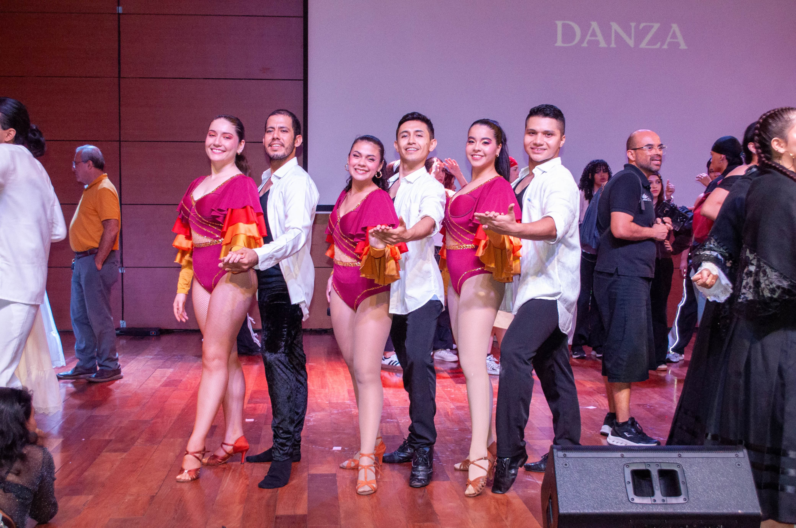

# Portafolio Artístico · Representativos Dancísticos de la EMA

Sitio web (portafolio digital) de una sola página, construido con **HTML, CSS, JavaScript y Bootstrap 5**, que reúne las ~20–24 "páginas" del portafolio: portada, carta de presentación, índice, los 4 representativos (Latin Dance, Tradicional, Contemporánea, Urbana), galería general, impacto, testimonios, créditos y contacto.

## Cómo verlo

Solo abre `index.html` en tu navegador (doble clic). No requiere instalación.

> Para que los códigos QR y los estilos de Bootstrap carguen, necesitas **conexión a internet** (se usan vía CDN).

Si prefieres un servidor local (recomendado para evitar bloqueos del navegador):

```bash
# Con Python instalado
python -m http.server 8000
# Luego abre http://localhost:8000
```

## Estructura del proyecto

```
portafolioema/
├── index.html        # Todas las secciones del portafolio
├── css/
│   └── styles.css    # Estilos y diseño responsive
├── js/
│   └── main.js       # QR, animaciones, contador, lightbox, navegación
├── assets/
│   └── img/          # Coloca aquí tus fotografías
└── README.md
```

## 1) Reemplazar las fotos (placeholders)

Cada foto es un bloque `<figure class="photo ...">` con un texto provisional. Para usar una foto real, agrega una etiqueta `` dentro del `figure` y añade la clase `has-img`:

```html
<!-- Antes (placeholder) -->
<figure class="photo photo-wide" data-photo="Presentación principal">
  <figcaption>Foto grande · Presentación destacada</figcaption>
</figure>

<!-- Después (con tu foto) -->
<figure class="photo photo-wide has-img" data-photo="Presentación principal">
  
  <figcaption>Foto grande · Presentación destacada</figcaption>
</figure>
```

Las proporciones disponibles son: `photo-portrait`, `photo-square`, `photo-wide`, `photo-tall`, `photo-mini`.

## 2) Cambiar los códigos QR

Los QR se generan solos a partir del atributo `data-qr`. Solo cambia la URL:

```html
<div class="qr-box" data-qr="https://www.youtube.com/watch?v=TU_VIDEO" data-qr-label="Video destacado"></div>
```

Ponle la URL real de tu video de YouTube, reel de Instagram, etc.

## 3) Editar textos

Abre `index.html` y reemplaza los textos provisionales:
- Nombres de directores, número de integrantes y frases de cada grupo.
- Logros, festivales y reconocimientos.
- Datos de créditos (coordinación, docentes, fotografía, diseño).
- Redes de la sección **Contacto** (Instagram, Facebook, correo).

## 4) Personalizar colores

En `css/styles.css`, dentro de `:root`, puedes cambiar la paleta:

```css
--accent: #c9305a;        /* color principal */
--latin: #e8462f;         /* color del grupo Latin Dance */
--tradicional: #1f9e6b;
--contemporanea: #6c4bd1;
--urbana: #1f8ae0;
```

## Tecnologías

- Bootstrap 5.3 (grid responsive, navbar, dropdowns)
- Bootstrap Icons
- Google Fonts (Cormorant Garamond + Montserrat)
- qrcodejs (generación de QR en el navegador)
